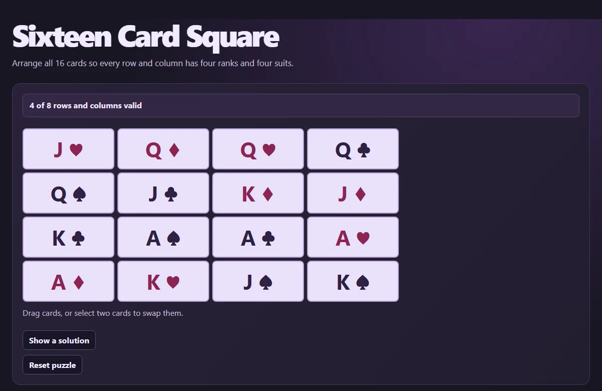

# Sixteen Card Square

Arrange all 16 cards so every row and column has four ranks and four suits.

[Open the web app](https://surfingcoder.com/apps/sixteen-card-square/)



## Run locally

Serve the repository with Python 3, then open http://127.0.0.1:8000/ in a current browser.

```sh
python -m http.server 8000 --bind 127.0.0.1
```

Use the controls next to the puzzle to swap or reset cards.

## Method

The rank and suit grids are Latin squares. The 16 distinct cards make them orthogonal when both sets of row and column rules are satisfied.

Inspired by Michael John Harris’s graduate proseminar, *On the Existence of Transversals in r-Multi Latin Squares* (2012).

## Verify

Run `node --test check.mjs` with Node.js 22 or newer. The check runs the app’s mathematical regression cases without a browser.
